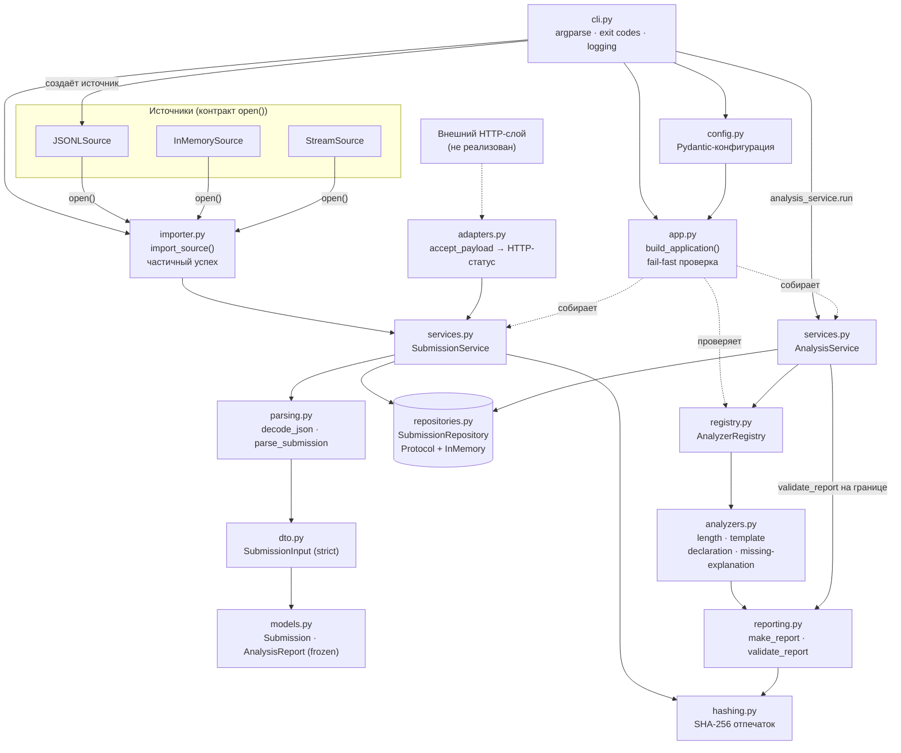

# Lab Analyzer: Система приема и анализа лабораторных работ

## Описание проекта
Ядро информационной системы онлайн-школы для приёма, валидации и хранения версий лабораторных работ. 
Система реализует конвейер обработки сдач: от  парсинга JSON до сохранения неизменяемых доменных моделей и разрешения коллизий (дубликатов и конфликтов). Код не исполняется, а рассматривается как текстовые данные.

## Возможности

| Область | Что реализовано |
|---|---|
| **Приём сдач** | Строгая валидация, версия схемы, часовой пояс обязателен |
| **Неизменяемость** | `frozen`+`slots` dataclass-модели; повтор ID без изменений → `duplicate`, с изменениями → `conflict`, исходник не перезаписывается |
| **Устойчивый хеш** | SHA-256 от канонического JSON; не зависит от порядка ключей и `PYTHONHASHSEED` |
| **Источники** | `InMemorySource`, `JSONLSource`, `StreamSource` с общим контрактом и гарантированным закрытием файла |
| **Импорт** | Частичный успех: `accepted` / `duplicate` / `errors` с номерами строк |
| **Анализаторы** | `length`, `template`, `declaration`, `missing-explanation`; подключаются регистрацией, без правки сервиса |
| **Расширяемость** | Реестр фабрик анализаторов: новый анализатор подключается одной регистрацией, без правки центрального сервиса |
| **Отчёты** | `analyzer_version`, `config_hash`, `evidence` со ссылками на исходные строки; проверка результата плагина на границе |
| **Backend-углубление** | Fail-fast валидация конфигурации при сборке, адаптер `accept_payload` (DTO → домен → приём) с отображением ошибок в HTTP-статусы |
| **CLI** | Команды `import` (с флагом `--analyze`) и `analyze <id> <имя>` (по уже загруженным в память данным); JSON в stdout, диагностика в stderr (`-v`), коды завершения 0/1/2 |

## Архитектура



## Сборка и запуск

**Требования:** Python 3.12+.

```bash
# 1. Окружение
python -m venv .venv
source .venv/bin/activate  # Windows: .venv\Scripts\Activate.ps1

# 2. Установка
python -m pip install -e '.[dev]'
```

### Импорт сдач

```bash
# Импорт учебного корпуса
lab-analyzer import data/submissions.jsonl

# Импорт + запуск всех анализаторов из конфигурации
lab-analyzer import data/submissions.jsonl --analyze --config data/config.example.json

# Файл с ошибками: код завершения 1, корректные записи всё равно приняты
lab-analyzer import data/invalid_submissions.jsonl

# Подробный журнал в stderr
lab-analyzer import data/submissions.jsonl -v

# Запуск одного анализатора для сдачи, уже находящейся в памяти процесса (id сдачи, имя анализатора)
lab-analyzer analyze sub-001 length   # в отдельном процессе вернёт код 1: хранилище пусто

# Эквивалентный запуск без установленной команды
python -m lab_analyzer import data/submissions.jsonl
```

| Код завершения | Значение |
|:-:|---|
| `0` | Всё успешно |
| `1` | Ошибки отдельных строк либо анализа (корректные записи приняты) |
| `2` | Источник или конфигурация недоступны / некорректны |

> Хранилище живёт в памяти процесса и между запусками не сохраняется. Поэтому команда `analyze <id> <имя>` не принимает путь к файлу и работает только с уже загруженными в память данными; для импорта и анализа за один запуск используйте `import PATH --analyze`.

Пример ответа `import` (stdout — всегда один JSON-документ):

```json
{"accepted": ["sub-001", "sub-002"], "duplicate": ["sub-001"],
 "errors": [{"line_no": 2, "code": "invalid_json", "field": "json", "message": "..."}]}
```

### Использование как библиотеки

```python
from lab_analyzer.app import build_application

app = build_application()                       # конфигурация проверяется сразу
app.submission_service.accept(raw_submission)   # dict из JSON
for report in app.analyze_all("sub-001"):
    print(report.analyzer_id, report.findings[0].explanation)
```

### Свой анализатор

Достаточно реализовать контракт и зарегистрировать фабрику — сервис менять не нужно:

```python
class MyAnalyzer:
    analyzer_id = "my"
    analyzer_version = "1.0"

    def analyze(self, submission, context):
        ...  # вернуть make_report(...)

registry.register("my", MyAnalyzer)
```

## Проверка качества

```bash
python -m pytest              # 242 теста
ruff check .                  # линтер
mypy src                      # строгая проверка типов
```


